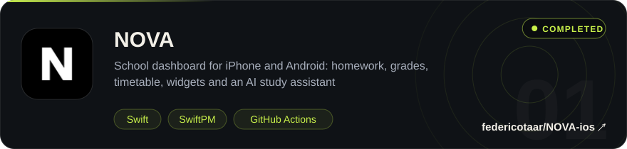
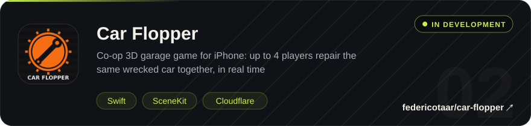
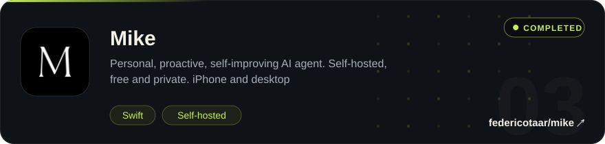
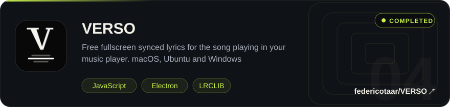
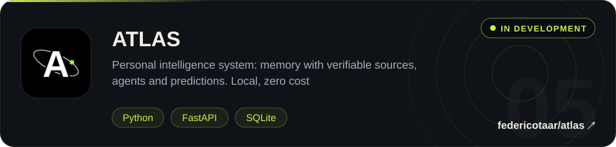
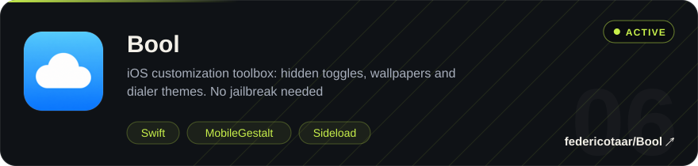
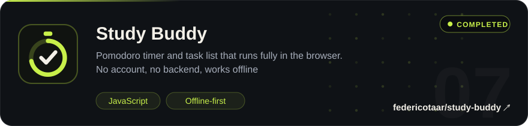
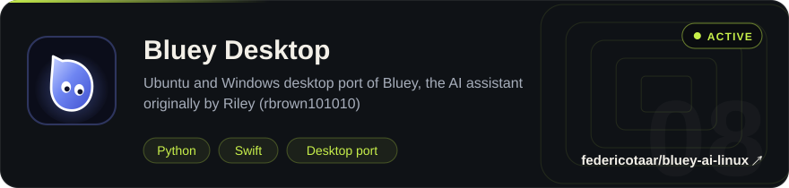
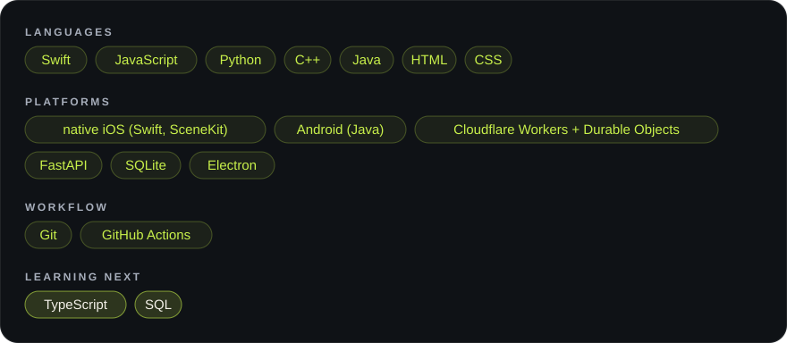

<a href="https://federicotaranu.com"><picture><source media="(max-width: 640px)" srcset="assets/v5/2-v5-banner-m.svg"></picture></a>

I'm an IT student in Ferrara and the developer behind Fredrich Labs, where I build iPhone apps, games and desktop tools. I work mainly in Swift, with Cloudflare and Python on the backend. Everything below is public, and each project ships without paid services behind it.

<picture><source media="(max-width: 640px)" srcset="assets/20-v4-h-work-m.svg"></picture>

<a href="https://github.com/federicotaar/NOVA-ios"><picture><source media="(max-width: 640px)" srcset="assets/3-v4-card-nova-m.svg"></picture></a>
**Finished:** open to bug reports only - [all releases](https://github.com/federicotaar/NOVA-ios/releases).

<a href="https://github.com/federicotaar/car-flopper"><picture><source media="(max-width: 640px)" srcset="assets/5-v4-card-carflopper-m.svg"></picture></a>
**In development:** co-op lobbies, 3D garage and repairs work; the released build is an unverified prerelease until on-device testing.

<a href="https://github.com/federicotaar/mike"><picture><source media="(max-width: 640px)" srcset="assets/7-v4-card-mike-m.svg"></picture></a>
**Finished:** iPhone app plus desktop preview for Ubuntu, Windows and macOS - [all releases](https://github.com/federicotaar/mike/releases).

<a href="https://github.com/federicotaar/VERSO"><picture><source media="(max-width: 640px)" srcset="assets/9-v4-card-verso-m.svg"></picture></a>
**Finished:** free and open source, no Spotify Premium needed - [all releases](https://github.com/federicotaar/VERSO/releases).

<a href="https://github.com/federicotaar/atlas"><picture><source media="(max-width: 640px)" srcset="assets/v5/4-v5-card-atlas-m.svg"></picture></a>
**In development:** phases 0-5 of 6 implemented and green in CI; connectors validated with synthetic fixtures.

<a href="https://github.com/federicotaar/Bool"><picture><source media="(max-width: 640px)" srcset="assets/v5/6-v5-card-bool-m.svg"></picture></a>
**Active:** unsigned IPA in [releases](https://github.com/federicotaar/Bool/releases), sideload with AltStore, SideStore or Sideloadly.

<a href="https://github.com/federicotaar/study-buddy"><picture><source media="(max-width: 640px)" srcset="assets/v5/8-v5-card-studybuddy-m.svg"></picture></a>
**Finished:** client-side only, MIT licensed - [try it](https://github.com/federicotaar/study-buddy).

<a href="https://github.com/federicotaar/bluey-ai-linux"><picture><source media="(max-width: 640px)" srcset="assets/v5/10-v5-card-bluey-m.svg"></picture></a>
**Active:** desktop bundles built in CI; original project by [rbrown101010](https://github.com/rbrown101010/bluey-by-riley).

<picture><source media="(max-width: 640px)" srcset="assets/22-v4-h-stack-m.svg"></picture>

<picture><source media="(max-width: 640px)" srcset="assets/26-v4-stack-m.svg"></picture>

<picture><source media="(max-width: 640px)" srcset="assets/24-v4-h-contact-m.svg"></picture>

<a href="https://federicotaranu.com"><picture><source media="(max-width: 640px)" srcset="assets/28-v4-contact-m.svg"></picture></a>

Contact form at [federicotaranu.com](https://federicotaranu.com) or email [support@federicotaranu.com](mailto:support@federicotaranu.com).
